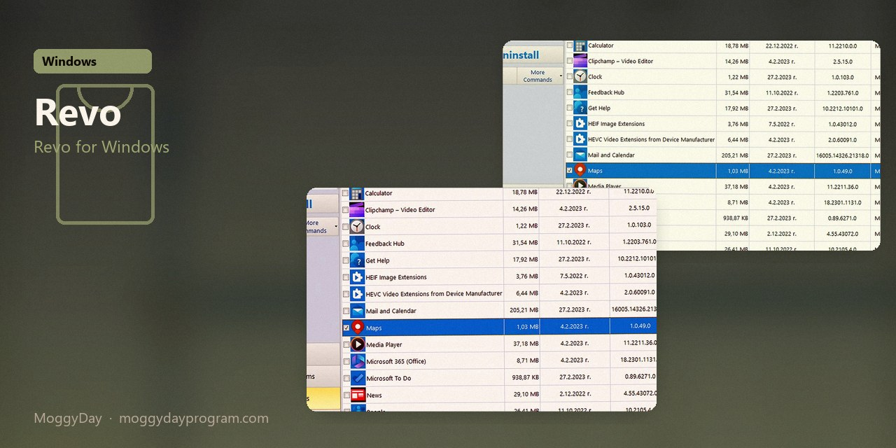
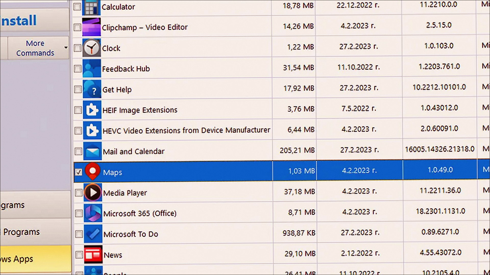
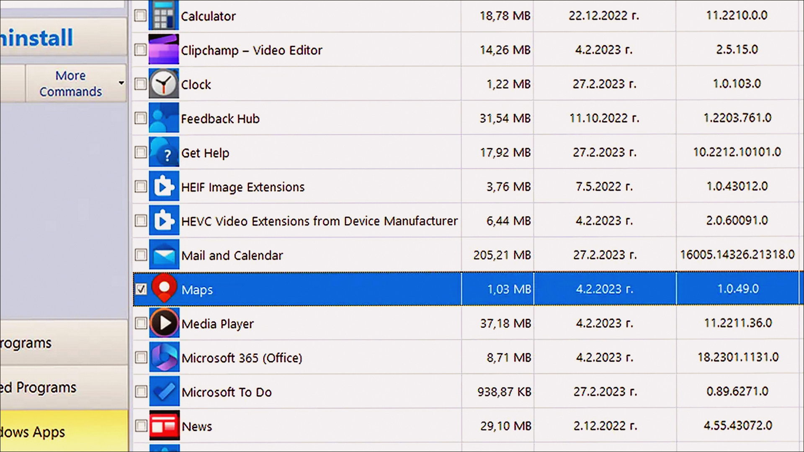
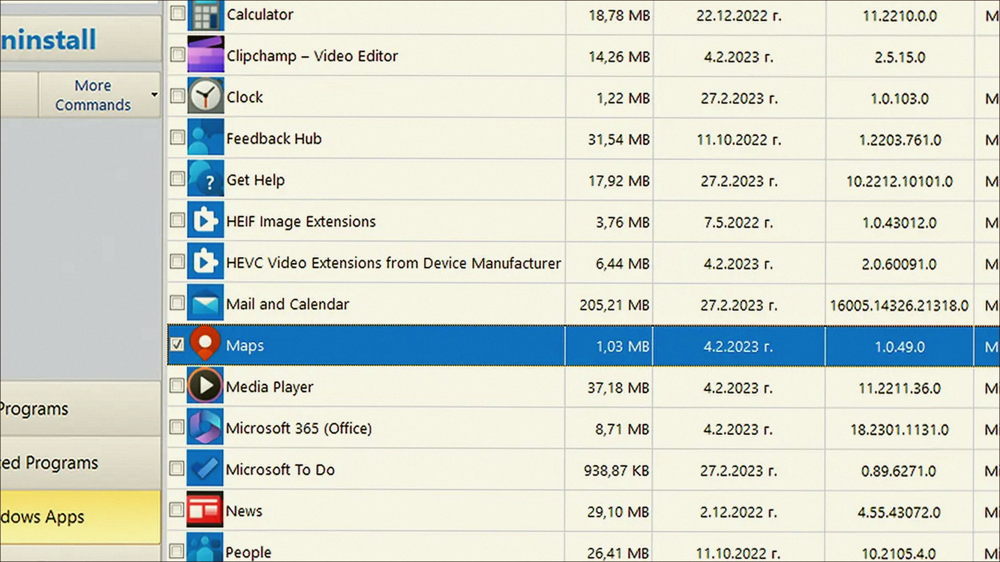

# Revo Uninstaller 5.5 v5.5.4 for Windows — MoggyDay

**Language / Язык:** the [GitHub Pages site](https://pieceenremember.github.io/revo-uninstaller-windows/) picks English or Russian from the browser. Switch: [English](https://pieceenremember.github.io/revo-uninstaller-windows/?lang=en) · [Русский](https://pieceenremember.github.io/revo-uninstaller-windows/?lang=ru)

Revo Uninstaller · MoggyDay · 5.5 · v5.5.4

# Revo Uninstaller 5.5 “for Windows: Revo for Windows” [v5.5.4]

  

  
  
  

MoggyDay keeps one stable URL for Revo Uninstaller: EN / RU. Revo Uninstaller on Windows 10/11 x64. 15 MB. Requirements, screenshots, MoggyDay Launcher.

## Download

1. Open [Revo Uninstaller EN](https://moggydayprogram.com/en/programs/revo-uninstaller) or [Revo Uninstaller RU](https://moggydayprogram.com/programs/revo-uninstaller).
2. Stay on moggydayprogram.com.
3. Use the primary button on that card. Prefer [MoggyDay Launcher](https://moggydayprogram.com/launcher) if the archive is large.
4. After a catalog update, reload the same program URL.

## Official links

| | URL |
| --- | --- |
| EN | https://moggydayprogram.com/en/programs/revo-uninstaller |
| RU | https://moggydayprogram.com/programs/revo-uninstaller |
| Hub | https://moggydayprogram.com/categories/utilities |
| Category | https://moggydayprogram.com/categories/utilities |
| Catalog | https://moggydayprogram.com/programs |
| Launcher | https://moggydayprogram.com/launcher |

## More programs on MoggyDay

- [IObit Uninstaller](https://moggydayprogram.com/programs/iobit-uninstaller)
- [Uninstall Tool](https://moggydayprogram.com/programs/uninstall-tool)

Canonical: https://moggydayprogram.com/programs/revo-uninstaller  
GitHub Pages: https://pieceenremember.github.io/revo-uninstaller-windows/  
No installer on this repo — packages live on the catalog site.
